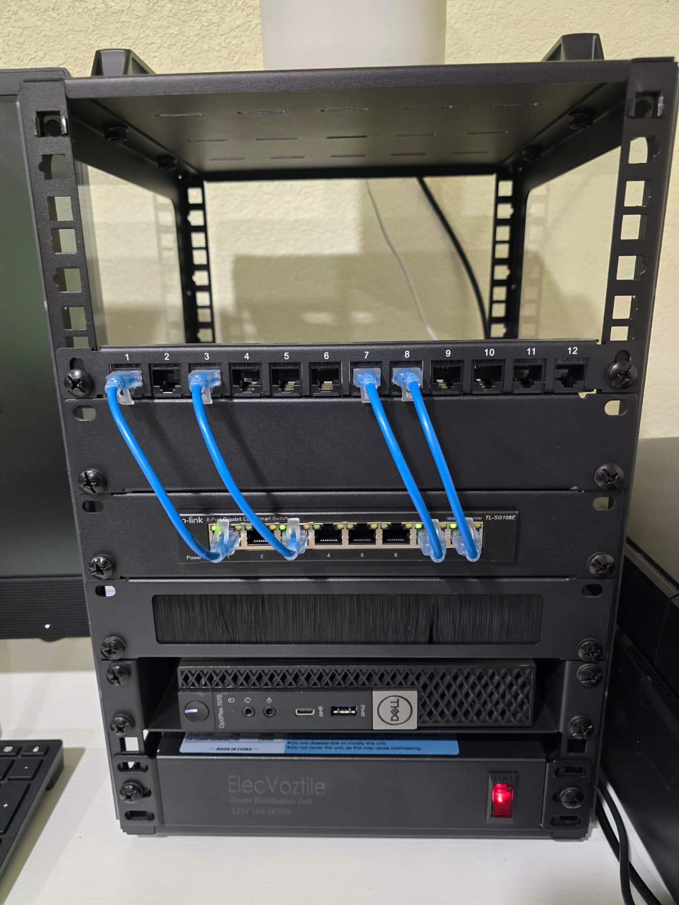

# 🏠 Homelab: Networking & Cybersecurity Lab

A small 10" rack homelab I'm building to practice networking, virtualization, and security hands-on after earning **CompTIA Security+**. Everything here runs on used business hardware and free, open-source software.



## Hardware

| Device | Role | Specs |
| --- | --- | --- |
| Dell OptiPlex 7070 Micro (`pve1`) | Lab node | i5-8500T (6 cores), 32 GB DDR4, 512 GB NVMe |
| Dell OptiPlex 3050 Micro (`pve2`) | Home services node | i5-7500 (4 cores), 16 GB DDR4, 128 GB SSD |
| ASUS laptop (`pds`) | Backup & monitoring server, cluster tie-breaker | Intel Core i3, 94 GB system disk |
| TP-Link TL-SG108E | Managed switch | 8-port gigabit, VLANs, port mirroring |
| 12-port Cat6 patch panel | Cabling | Ports mapped 1:1 to switch ports |
| ElecVoztile PDU | Power | 125 V / 15 A |

## Network design

```
Internet
   │
ISP gateway (home network)
   │
TL-SG108E switch
   ├── pve1 (Proxmox VE, lab)
   │     ├── vmbr0 ── home network
   │     │     └── pfSense WAN
   │     └── vmbr1 ── isolated lab network (192.168.1.0/24)
   │           └── pfSense LAN → lab VMs / containers
   ├── pve2 (Proxmox VE, home services)
   │     └── Pi-hole
   └── pds (Proxmox Backup Server)
         └── Uptime Kuma
```

- `pve1` and `pve2` form a **Proxmox cluster**, managed from one dashboard. The laptop provides a third **tie-breaker vote (QDevice)** without joining the cluster, which keeps the backup server separate.
- The lab network sits behind its own pfSense firewall, so anything I test there can't reach devices on my home network.
- Remote access is through **Tailscale** only, with no ports open to the internet.

## Projects

| # | Project | Skills |
| --- | --- | --- |
| 01 | [pfSense firewall & lab isolation](projects/01-pfsense-lab-isolation/README.md) | Virtualization, firewalls, network segmentation, log analysis |
| 02 | [Secure backups with Proxmox Backup Server](projects/02-secure-backups/README.md) | Backup & recovery, least privilege, troubleshooting |
| 03 | [Ad blocking & service monitoring (Pi-hole + Uptime Kuma)](projects/03-pihole-uptime-kuma/README.md) | DNS, Linux containers, systemd, monitoring & alerting |

## Roadmap

- [x] Proxmox VE on the OptiPlex 7070
- [x] pfSense firewall with an isolated lab network
- [x] Nightly backups to a separate server
- [x] Secure remote access with Tailscale
- [x] Second node (OptiPlex 3050) and a Proxmox cluster with a QDevice
- [x] Pi-hole DNS filtering
- [x] Uptime Kuma monitoring with phone alerts
- [ ] Home Assistant
- [ ] Jellyfin media server
- [ ] Wazuh SIEM + Kali Linux for attack-and-detect practice
- [ ] Suricata IDS using switch port mirroring
- [ ] VLANs on the managed switch
- [ ] NAS for media, photo backups and file shares

## Certifications

CompTIA A+ · Network+ · Security+ · Google IT Support Professional Certificate
