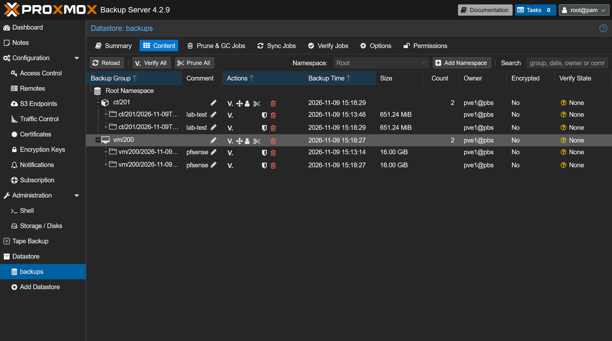
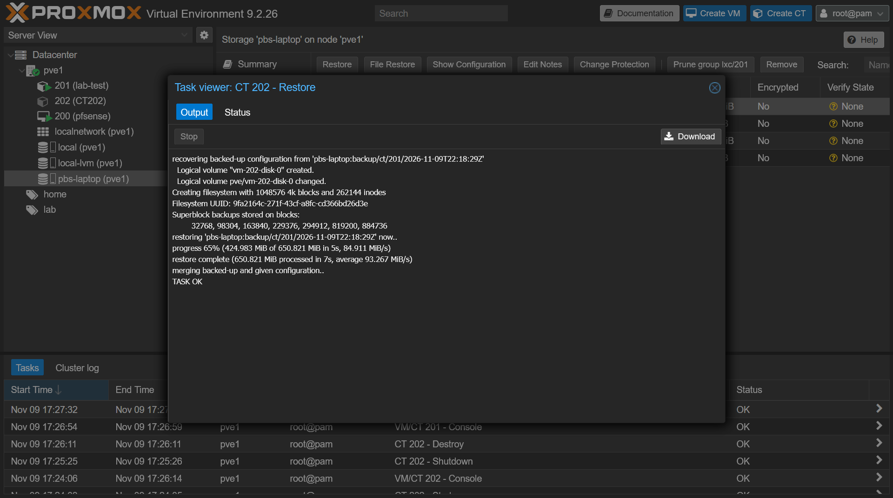

# 02 · Secure Backups with Proxmox Backup Server

## Goal

Back up every VM and container on `pve1` every night to a **separate machine**, in a way that ransomware on the hypervisor could not destroy.

## What I built

- **Proxmox Backup Server** installed on an old laptop running Proxmox VE
- A datastore called `backups` on the laptop's internal disk
- A **backup-only user** for `pve1` (least privilege)
- A nightly backup job at 02:00 for all guests
- Cleanup (pruning) and garbage collection run **on the backup server**, not by the client

## Design: least privilege

The `pve1@pbs` account has only the **DatastoreBackup** role. It can create and restore backups but **cannot delete them**.

| Task | Who does it | Why |
| --- | --- | --- |
| Create backups | `pve1` (backup-only user) | Needs write access only |
| Prune old backups | Backup server (daily job) | A compromised hypervisor can't erase history |
| Garbage collection | Backup server (weekly) | Frees space from pruned data |

Retention: **7 daily, 4 weekly**.

## Steps

1. Reinstalled the laptop with Proxmox VE and set it to keep running with the lid closed.
2. Added the Proxmox Backup Server repository and installed `proxmox-backup-server`.
3. Created the `backups` datastore and a weekly garbage-collection schedule.
4. Created user `pve1@pbs` with the **DatastoreBackup** role on `/datastore/backups`.
5. Added the backup server to `pve1` as storage, verified by its certificate fingerprint.
6. Created the nightly backup job, ran it once by hand, then tested a restore.

## Problems & fixes

| Problem | Cause | Fix |
| --- | --- | --- |
| Backup succeeded but job ended with `permission check failed - missing Datastore.Modify\|Datastore.Prune` | The client tried to prune, but the backup-only role can't delete | Kept the restricted role, set the client job to keep all backups, and created a prune job on the backup server instead |
| Commands didn't run | Several commands pasted onto one line | Ran each command on its own line |

## Results

- First backup of the test container: **650 MB compressed to 225 MB in about 9 seconds**
- Backups appear on the server under `vm/200` (pfSense) and `ct/201` (lab-test)
- Restore tested: 650 MB container restored to a new ID in 7 seconds

## What I learned

- A backup isn't real until you've restored from it.
- Least privilege applies to service accounts too, not just people.
- Moving deletion rights to the backup server is a simple, strong ransomware defense.

