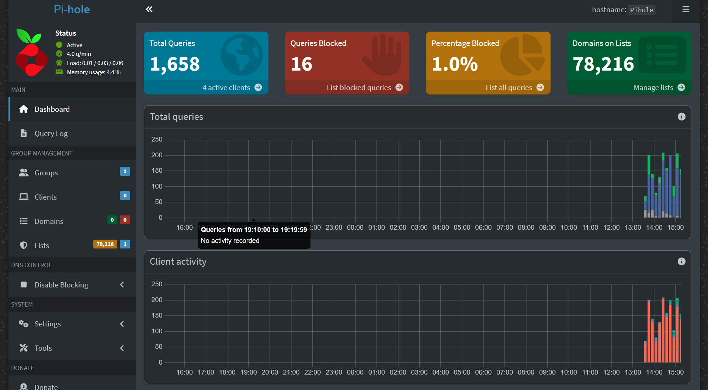
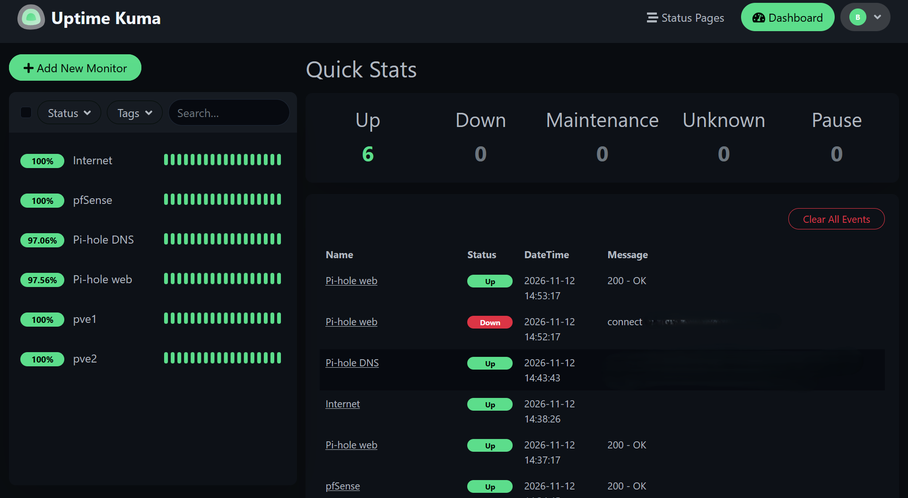
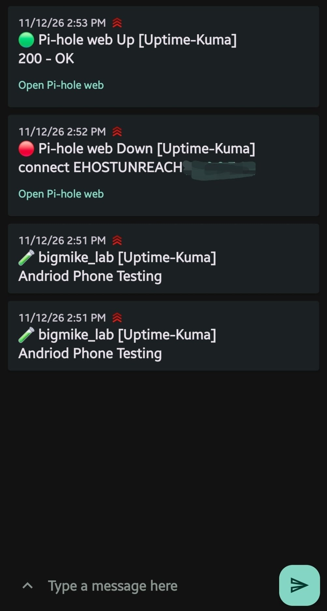

# 03 · Network-Wide Ad Blocking & Service Monitoring

**Pi-hole** for DNS filtering and **Uptime Kuma** for monitoring, with alerts pushed to my phone.

## Goal

1. **Filter DNS** to block ads, trackers, malware and phishing domains before devices ever connect to them.
2. **Watch every service** in the lab and get an alert on my phone the moment something goes down, from a machine that isn't the one being watched.

## Where everything runs

| Service | Host | Container | Address | Resources |
| --- | --- | --- | --- | --- |
| Pi-hole | `pve2` (home node) | CT 101, Debian 13, unprivileged | `10.0.0.7` | 1 core, 512 MB RAM, 4 GB disk |
| Uptime Kuma | `pds` (backup and monitoring server) | CT 120, Debian 13, unprivileged | `10.0.0.8:3001` | 1 core, 1 GB RAM, 8 GB disk |

```
           ┌───────────────────── checks every 60 s ─────────────────────┐
           │                                                             ▼
  pds: Uptime Kuma ──► pve1 :8006   pve2 :8006   pfSense :443   Pi-hole :53 / :80   1.1.1.1
           │
           └──► ntfy.sh ──► push alert on my phone (🔴 DOWN / 🟢 UP)

  My PC ──DNS──► Pi-hole (pve2) ──► Quad9 (filtered, DNSSEC) ──► internet
                     └── blocked domains answered with 0.0.0.0
```

---

## Part 1 · Pi-hole

### Why

DNS is the first thing every device does before loading anything. Filtering at that step blocks ads and tracking for every app and browser on a device, not just one browser with an extension. It also gives me a log of every domain a device tries to reach, which is useful for spotting suspicious traffic.

### Build steps

1. Downloaded the Debian 13 container template to `pve2` (templates are stored per node).
2. Created **CT 101** on `pve2`: unprivileged, resource pool `home`, bridge `vmbr0` (home network), static IP `10.0.0.7/24`.
3. Installed Pi-hole with the official installer:
   ```bash
   apt update && apt upgrade -y
   apt install curl -y
   curl -sSL https://install.pi-hole.net | bash
   pihole setpassword
   ```
4. Installer choices:

| Setting | Choice | Reason |
| --- | --- | --- |
| Upstream DNS | **Quad9 (filtered, DNSSEC)** | Adds malware and phishing blocking at the upstream resolver |
| ECS | Avoided | ECS shares part of my home IP with the websites I visit |
| DNSSEC | On | Checks DNS answers haven't been tampered with |
| Blocklist | Default (78,216 domains) | Solid starting point |
| Query logging | On, privacy level 0 | Full visibility for learning and troubleshooting |

### Verifying it

```cmd
ipconfig /flushdns
nslookup doubleclick.net 10.0.0.7
```

A blocked domain comes back as `0.0.0.0`. ✅



### Rollout

My ISP gateway **doesn't allow changing the DNS server it hands out**, so I can't point the whole house at Pi-hole yet. For now, I set DNS manually per device (`10.0.0.7`). When I add my own router (UniFi Cloud Gateway), Pi-hole will cover the whole network from one setting.

---

## Part 2 · Uptime Kuma

### Why it runs on the backup server

A monitor that runs on the machine it watches can't report when that machine dies. Running Uptime Kuma on `pds` means it can still alert me if `pve1` or `pve2` goes down.

The container also uses **public DNS (1.1.1.1), not Pi-hole**, so monitoring keeps working even when Pi-hole is the thing that's broken.

### Build steps

1. Created **CT 120** on `pds`: unprivileged, static IP `10.0.0.8/24`, DNS `1.1.1.1`.
2. Installed Node.js and Uptime Kuma 2.5.11 from source:
   ```bash
   apt install -y git curl nodejs npm      # Node.js 20.19
   git clone https://github.com/louislam/uptime-kuma.git /opt/uptime-kuma
   cd /opt/uptime-kuma && npm run setup
   ```
3. Created a **systemd service** so it starts at boot and restarts if it crashes:
   ```ini
   [Unit]
   Description=Uptime Kuma
   After=network.target

   [Service]
   WorkingDirectory=/opt/uptime-kuma
   ExecStart=/usr/bin/node server/server.js
   Restart=always

   [Install]
   WantedBy=multi-user.target
   ```
   ```bash
   systemctl daemon-reload && systemctl enable --now uptime-kuma
   ```
4. Chose **SQLite** as the database: a single file, nothing extra to maintain, and it's included in the container's nightly backup.

### Monitors

| Monitor | Type | What it proves |
| --- | --- | --- |
| pve1 | HTTPS `:8006` | Lab node's Proxmox web interface is up |
| pve2 | HTTPS `:8006` | Home node's Proxmox web interface is up |
| pfSense | HTTPS `:443` | Lab firewall is up |
| Pi-hole DNS | DNS lookup of `google.com` via `10.0.0.7:53` | Pi-hole is **actually resolving names**, not just serving its web page |
| Pi-hole web | HTTP `/admin` | Pi-hole admin page is up |
| Internet | Ping `1.1.1.1` | Home internet connection is up |

All monitors check every 60 seconds, with 1 retry so a single dropped check doesn't cause a false alarm. Self-signed certificates are accepted for the internal HTTPS checks.



### Phone alerts with ntfy

- Notification type **ntfy** via `ntfy.sh`, priority 5 (urgent), applied to every monitor.
- The ntfy topic is a **long random name**, because anyone who knows a topic name can read its messages. It's treated like a password and kept out of screenshots.
- Tapping an alert opens the affected service.

### Failure test

I shut down the Pi-hole container on purpose:

1. Within about a minute, my phone got **🔴 DOWN** alerts for *Pi-hole DNS* and *Pi-hole web*.
2. After starting the container again, I got **🟢 UP** alerts.



---

## Problems & fixes

| Problem | Cause | Fix |
| --- | --- | --- |
| Pi-hole error: `Failed to adjust time during NTP sync: Insufficient permissions` | Pi-hole 6's built-in clock sync tries to set the system time, which an **unprivileged container** isn't allowed to do. That's the container's security working as intended. | Disabled Pi-hole's NTP sync (`pihole-FTL --config ntp.sync.active false`). The host keeps the time, and the container inherits it. |
| Multi-line commands pasted incorrectly into the container console | The default noVNC console doesn't handle pasted text well | Switched the console to **xterm.js**, which pastes reliably |
| Uptime Kuma logs showed UTC times | Containers default to UTC | Set Uptime Kuma's display timezone to America/Denver |
| Can't set Pi-hole for the whole house | ISP gateway locks its DNS settings | Per-device DNS for now; whole-network DNS once my own router is in place |
| Possible Pi-hole bypass on some devices | The ISP gateway also hands out **IPv6 DNS**, which can skip Pi-hole | Watch the query log; set IPv6 DNS manually where needed |

## Security decisions

| Decision | Why |
| --- | --- |
| Both services in **unprivileged** containers | A compromised service can't easily gain root on the Proxmox host |
| Upstream DNS with **malware filtering + DNSSEC** | Adds a second layer of protection behind the blocklists |
| Monitoring on a **separate machine** | The monitor survives when the thing it's monitoring fails |
| Monitor uses **public DNS**, not Pi-hole | Monitoring doesn't depend on the service it's watching |
| ntfy topic treated as a secret | Prevents others from reading my infrastructure alerts |
| Nothing exposed to the internet | All remote access goes through Tailscale |

## What I learned

- DNS is a powerful, simple control point for both privacy and security.
- **Test the function, not just the page.** A DNS lookup check catches failures an HTTP check would miss.
- Monitoring belongs on a different machine than the things it monitors, and it shouldn't depend on them.
- Container permission errors are often security features working as designed. The fix is to adjust the app, not to weaken the container.
- An alert you've never triggered on purpose is an alert you don't know works.

## Next

- Pi-hole for the whole network once my own router is in place
- A second Pi-hole for redundancy
- Uptime Kuma status page for the rack display
- Tailscale subnet router so alert links open from anywhere
